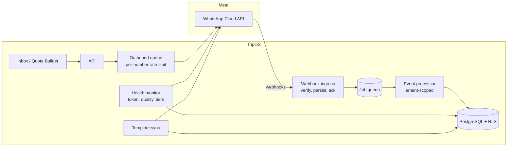
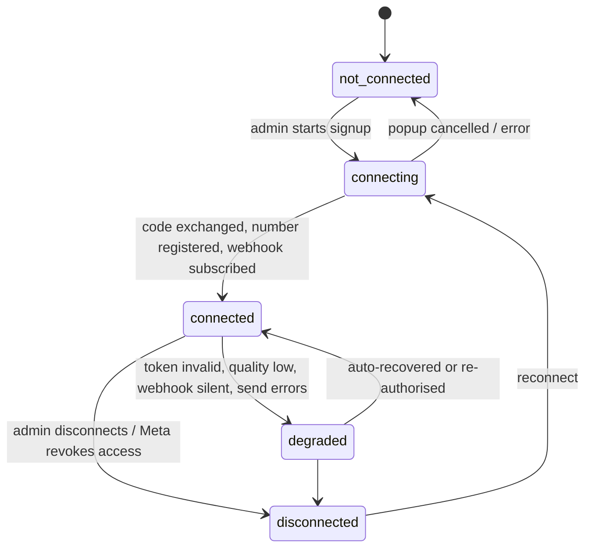
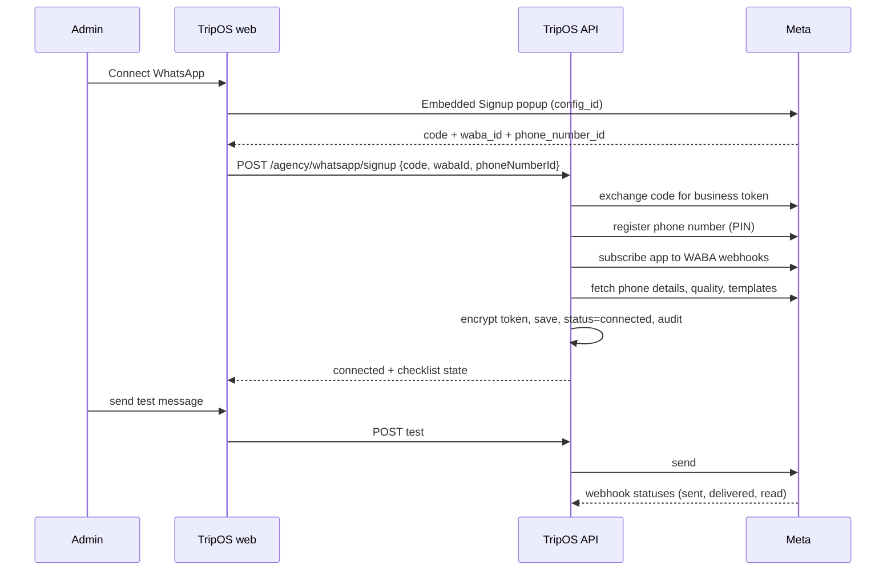

# WhatsApp Integration Design (onboarding and scale)

Status: **proposal**. It builds on what exists (`providers/whatsapp`, `webhooks`, `outbound.service.ts`, `WhatsappAccount`) and on `WHATSAPP_GO_LIVE.md`. Statements about Meta's APIs are from the author's knowledge and **must be verified against Meta's current documentation** before implementation; items to verify are listed in section 11.

## 1. Goals
1. A new agency connects its own WhatsApp number in **minutes, self-service**, with no developer involved.
2. One platform deployment serves **many agencies** with isolation, fair sharing and per-agency cost visibility.
3. Failures (revoked token, quality drop, webhook gaps, Meta outages) are **detected and explained**, not discovered by customers.
4. Meta is accessed only through the existing `WhatsAppProvider` interface; business logic does not change.

## 2. Where we are
| Exists | Missing |
|---|---|
| Signature-verified webhook, tenant resolved from `phone_number_id`, de-duplication, forward-only statuses | Webhook processing is **inline** (no durable inbox, no replay) |
| Outbound with idempotency, 24 h window and template checks, per-item quote retry | No **outbound rate limiting** per number; no token-failure handling |
| Manual connect (paste WABA ID, phone ID, token) | **No webhook subscription** call, no Embedded Signup, no health state |
| Template drafts and statuses | **No submission or status sync** with Meta |
| Message `simulated` flag | **No usage/cost metering** per agency |

## 3. Meta model: Tech Provider with one platform app
- TripOS owns **one Meta app**. Each agency owns its **own WhatsApp Business Account (WABA)** in its own Meta business portfolio, shared to our app through **Embedded Signup**.
- All agencies send webhooks to **one callback URL** (`/webhooks/whatsapp`). The destination `phone_number_id` identifies the tenant (already implemented; `phoneNumberId` is globally unique).
- Each agency's payment method sits on **its own WABA**, so Meta bills the agency directly.
- Fallback for early clients: **assisted manual connect** (today's flow) using a system-user token, until Tech Provider approval is granted.

## 4. Connection lifecycle
`WhatsappAccount` gains an explicit state machine so the UI and monitors share one truth.

New fields on `WhatsappAccount` (migration): `status`, `businessId`, `tokenExpiresAt?`, `qualityRating`, `messagingLimitTier`, `displayNameStatus`, `subscribedAt`, `lastWebhookAt`, `lastErrorCode`, `lastErrorAt`, `statusReason`. Keep one account per agency for now; allow several later by relaxing the unique constraint on `agencyId` (the inbox then needs a "from number" selector).

## 5. Onboarding flow (what the agency admin sees)
Settings → WhatsApp becomes a **wizard**:
1. **Checklist:** Meta business account, a phone number that can receive an SMS/voice code, a payment method.
2. **Connect with Facebook:** Meta's Embedded Signup popup; the admin logs in, picks or creates the business and WABA, adds and verifies the number.
3. **We finish automatically** (server side, see sequence).
4. **Send a test message** to the admin's own phone and see delivered/read.
5. **Go-live checklist:** display name approved, payment method on file, quality rating, first templates synced.

Server steps must be **idempotent and resumable**: if step 3 fails halfway, the status stays `connecting` with a clear reason and the admin can retry from the failed step. Reusing a `phoneNumberId` already linked to another agency is rejected.

Edge cases to handle: number already on the WhatsApp Business app (migration or coexistence options); admin closes the popup; display name rejected; payment method missing (Meta stops chargeable sends); the person who signed up leaves the agency (reconnect path); Meta revokes access (webhook or error 190 sets `degraded`, banner plus email to the admin).

## 6. Inbound pipeline (reliable and replayable)
1. Webhook handler: verify signature on the raw body, **store the raw payload** in an inbox table (`WebhookInbox`: id, receivedAt, payload, status), return **200 within about a second**.
2. A worker picks events from the queue and processes them in the **tenant transaction** (existing code path), marking each `processed` or `failed` with the error.
3. **Replay tool:** re-run failed or all events for a time window (the raw payload is the source of truth).
4. **Out-of-order events:** a status webhook can arrive before the outbound message row is committed; park it as `pending_reconcile` and retry a few times.
5. **Gap detection:** if `lastWebhookAt` is silent for an account that is actively sending, mark `degraded` and alert.
Meta retries failed webhooks for a limited time (verify), so ingress must stay fast and available.

## 7. Outbound pipeline (fair and rate-limited)
- Today, sends happen inline in the request. Move customer-facing sends onto the **queue** with:
  - a **token bucket per phone number** (Meta's per-number throughput and the per-recipient pair limits; verify current values), with back-off and re-queue on rate-limit errors;
  - **per-agency concurrency caps** so one agency's bulk activity cannot starve others;
  - the existing **idempotency keys** and per-item quote attempts.
- Map Meta error codes to a **taxonomy**: `retryable` (rate limit, transient), `window_closed`, `template_problem`, `recipient_unreachable`, `auth_failed` (flips the account to `degraded`), `policy`. The UI shows a plain-language reason and the right action.
- **Reuse uploaded media:** Meta returns a media ID after upload that can be reused for a limited time (verify); cache it per asset so a vehicle photo sent to many customers is uploaded once. This also cuts send latency.

## 8. Template manager
- Create locally, **submit to Meta** (name, language, category, body, variable examples), store `providerTemplateId`.
- **Status sync:** handle template-status and template-category-change webhooks, plus a periodic full sync as a safety net.
- Warn when Meta re-categorises a template (it changes price). Block sends for non-approved templates (already enforced).
- Ship a **starter set** of utility templates (quote follow-up, quote expiring) for each new agency to submit in one click.

## 9. Usage and cost metering
- Meta status webhooks include **pricing information** (billable flag and category; verify field names). Store it on each message (`billable`, `pricingCategory`).
- Aggregate per agency per month: messages by category, free-tier consumption, estimated cost in INR plus GST.
- Show the admin a **usage card** and give you a platform report for pass-through or plan-limit decisions.
- Cost levers as product settings: **photos inside the PDF only** (a quote becomes 2 messages instead of 5), reminder to reply within the window, awareness of free entry points from ads.

## 10. Scale and operations
| Concern | Design |
|---|---|
| Volume | 100 agencies × 5,000 messages/month is about 0.2 messages/second on average; peaks maybe tens per second. PostgreSQL and the current queue are sufficient. |
| API | Stateless replicas behind a load balancer. |
| Workers | Separate process from the API; scale on queue depth. Introduce **Redis/BullMQ** only when sustained load or job latency requires it; `JobsService` is the seam. |
| Realtime inbox | Move polling to **SSE**; fan out via Postgres `LISTEN/NOTIFY`, later Redis pub/sub. |
| Isolation | RLS already protects data; add per-agency queue fairness and rate caps. |
| Media | Private S3 bucket with lifecycle rules; inbound media size/type allow-list (exists). |
| Retention | Configurable per agency; never delete sent-quote history. |
| Observability | Metrics: webhook lag, queue depth, send success rate per agency, error taxonomy counts, quality rating, token age. Alerts on: webhook silence, `auth_failed` spikes, quality drop, queue backlog. A Super Admin **WhatsApp health** table (status per agency). |
| Disaster | Raw webhook store plus replay; Meta outage means sends queue and retry. |

## 11. To verify against Meta's current documentation
Embedded Signup parameters and returned fields; token type and lifetime for a Tech Provider; number registration and two-step PIN requirements; webhook subscription endpoint; webhook fields available (messages, template status, quality, account updates); pricing object in status webhooks; per-number throughput and pair rate limits; messaging-limit tiers and verification impact; media ID lifetime; webhook retry policy; coexistence with the WhatsApp Business app; Tech Provider and app-review requirements; billing and credit-line options.

## 12. Delivery plan
| Phase | Scope | Rough effort | Depends on |
|---|---|---|---|
| **A: first real test** | Subscribe webhook on connect; template submit and sync; token and phone health check; error taxonomy | 5-8 days | Meta app and test number |
| **B: self-service onboarding** | Embedded Signup wizard, status machine, resumable server steps, test message, go-live checklist, data-deletion endpoint, legal pages | 8-12 days | Meta Tech Provider approval and app review |
| **C: robustness** | Webhook inbox and replay; outbound queue with rate limits and fairness; media ID reuse; health monitor and alerts | 8-10 days | Phase A |
| **D: money** | Usage metering, usage card, platform cost report, "photos in PDF only" setting | 5-7 days | Phase A |
| **E: scale** | SSE realtime, optional Redis/BullMQ, multiple numbers per agency, optional BSP fallback | 10-15 days | Real usage data |
Each phase ships behind the existing provider interface and keeps the simulator working for tests.

## 13. Testing strategy
Keep the simulator as the default test double and extend it to model: signup responses, token revocation, rate-limit errors, out-of-order and duplicate webhooks, template status changes and pricing metadata. Add contract tests that replay **recorded real Meta payloads** (captured during Phase A) so the parser is tested against reality. Add an end-to-end staging checklist with a real test number before each production release.

## 14. Open decisions
Tech Provider vs a BSP (affects onboarding, support, margins) · one number per agency or several · who pays Meta (default: each agency directly) · coexistence support for agencies already using the WhatsApp Business app · data retention and consent capture (opt-in) rules per agency.
